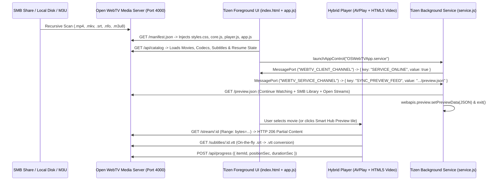

# Open WebTV Architecture Overview

## 1. End-to-End Media & Tizen IPC Architecture

---

## 2. Module Responsibilities

| Module | File Path | Responsibility |
| :--- | :--- | :--- |
| **Tizen Widget Manifest** | [`src/config.xml`](../src/config.xml) | Declares `OSWebTVApp.OpenWebTV`, `OSWebTVApp.service`, `bg_service` preview metadata, and TV privileges |
| **Dynamic Bundle Loader** | [`src/manifest-loader.js`](../src/manifest-loader.js) | Fetches `/manifest.json` with exponential backoff retries and injects `styles.css`, `core.js`, `player.js`, and `app.js` |
| **Foreground IPC & Key Bridge** | [`src/app-ipc-bridge.js`](../src/app-ipc-bridge.js) | Registers TV remote media keys and manages `WEBTV_CLIENT_CHANNEL` ↔ `WEBTV_SERVICE_CHANNEL` MessagePorts |
| **Smart Hub Preview Service** | [`src/service/service.js`](../src/service/service.js) | Fetches `/preview.json`, validates the schema, updates `webapis.preview.setPreviewData`, and exits cleanly |
| **SMB & Media Catalog Engine** | [`dev-server/media-catalog.js`](../dev-server/media-catalog.js) | Scans mounted SMB/local directories, parses release filenames/codecs, converts `.srt` → `.vtt`, and tracks resume progress |
| **Hybrid Video Player** | [`dev-server/public/player.js`](../dev-server/public/player.js) | Provides unified playback across Samsung hardware `webapis.avplay` and HTML5 `<video>` |
| **10-Foot Media Center UI** | [`dev-server/public/app.js`](../dev-server/public/app.js) | D-Pad navigable media library, OSD video player controls, category filtering, and live SMB/M3U source mounting |
